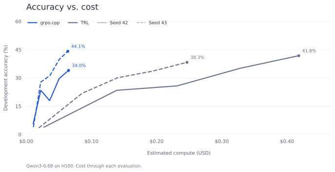
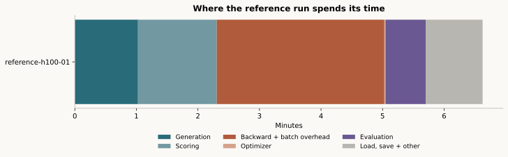

# Countdown pilot

The first question is whether Qwen3-0.6B can learn this short task cheaply.
This directory fixes the task and measures a Transformers/TRL reference run
before we build the native model path.

The first 64-update run went from 10/256 to 107/256 solved development
puzzles: **3.9% to 41.8%**. It took 6 minutes 38 seconds on one H100 and
reserved 12.83 GiB. Estimated compute was $0.46, excluding image build,
pre-entry startup, storage and network. This is one seed; final testing and
the native comparison are still ahead.





```text
Numbers: 3, 7, 8
Target: 45

(8 + 7) * 3
```

Only one expression is accepted. It must use every input exactly once and
reach the target using `+`, `-`, `*`, `/` and parentheses. The verifier uses
exact fractions. Extra prose, decimals, unary signs, extra numbers and code
are rejected. A valid expression at the token cap can earn reward; the report
records whether it ended with EOS separately. There is no formatting reward.

## Run it

From the repository root:

```bash
python3 -m unittest discover -s tests -p 'test_countdown.py' -v
uv run --with pyarrow==24.0.0 python experiments/countdown/prepare.py
modal run experiments/countdown/modal_run.py --run-id calibration-01
modal run experiments/countdown/modal_run.py --run-id reference-01 --mode train --steps 64
```

Each call runs one L4 with two CPU cores and 16 GiB RAM, no retry, a 60-minute
timeout and a training stop check after 50 minutes. One hour at the recorded
rates is about $1.02 for those requested resources, before startup, storage,
network and image-build costs. Keep the first calibration/pilot stage within
$5 and inspect each result before starting another job. This is a per-job
bound; the script does not enforce an account-wide spending limit.

If L4 capacity is unavailable, `--gpu H100` uses a 20-minute hard timeout and
checks for a training stop after 15 minutes. Its requested resources cost about
$1.39 for the full 20 minutes, with the same exclusions. An H100 run does not
prove L4 fit; never compare its timings directly with an L4 result.

`config.json` pins the model, data and recipe. `data_manifest.json` pins the
actual split bytes. `requirements.lock` pins the resolved Linux/Python 3.11
environment, including transitive dependencies. The source has 490,364 rows and 200,402 distinct
three-number puzzles. We hash each sorted input multiset plus target, sort
those hashes using a fixed seed, then take 128 calibration, 256 development,
512 final-test and 8,192 training puzzles. Source row order and permutations
cannot cross splits. The pilot does not read final-test puzzle contents.

The prompt includes two solved examples, neither present in the data splits.
The runner uses full-support sampling at temperature 1, eight completions per
prompt and a 64-token cap. Each optimizer update sees four prompts, with two
completions per training microbatch. Rewards are centered within each group,
without standard-deviation scaling. Sequence-mean GRPO, one policy pass and
zero KL make the first update easy to compare with the existing C++ loss.

Trainable parameters and AdamW state use FP32, with BF16 autocast and gradient
checkpointing. TRL 1.16's tiled output head is part of the reference. A native
comparison must match this task, objective and sampling contract, and account
for any precision difference.

## Read the result

Small measurement files return to `runs/countdown/<run-id>/`. Model checkpoints
stay under the same ID in the `grpo-countdown` Modal volume. Training saves
ordinary HF model checkpoints every 16 updates and checks a final reload by
comparing sampled token IDs on 32 development prompts. These model-only
checkpoints do not contain optimizer state for an exact training resume.

- `metadata.json`: recipe, source hashes, dependency versions and data identity.
- `answers.jsonl`: every calibration/development answer and exact verdict.
- `evaluations.jsonl`: held-out pass@1, lengths, cap counts and memory.
- `rollouts.jsonl` and `training.jsonl`: sampled training answers and trainer logs.
- `summary.json`: completion status and synchronized stage timings.
- `container.json`: function runtime and rate-based compute estimate.

Timing uses synchronized wall-clock intervals. Generation, reward, model
scoring, loss, optimizer and evaluation have separate intervals. The remaining
training-step time includes backward and batch preparation; it is not a pure
kernel measurement. Synchronization adds overhead. Estimated dollars are
computed from elapsed time and public rates, not claimed as invoiced spend.
Checkpoint reload and other unclassified overhead remain in total elapsed time.

Generate the plots and a standalone answer viewer from saved measurements:

```bash
uv run --with matplotlib==3.10.8 python experiments/countdown/report.py \
  runs/countdown/calibration-01 runs/countdown/reference-01 \
  --output runs/countdown/report
```

You can pass just the calibration directory before a training run exists.
The report saves SVG and PNG figures beside `report.html`. Learning curves
show sampled development pass@1; their intervals describe uncertainty across
puzzles, not variation across independent training runs.

The measurements and raw answers from the first runs are in `results.tar.gz`.
To redraw these figures without a GPU:

```bash
mkdir -p runs/countdown
tar -xzf experiments/countdown/results.tar.gz -C runs/countdown
uv run --with matplotlib==3.10.8 python experiments/countdown/report.py \
  runs/countdown/calibration-h100-02 runs/countdown/calibration-h100-03 \
  runs/countdown/reference-h100-01 --output runs/countdown/report
```

The final weights are in the `grpo-countdown` Modal volume at
`reference-h100-01/final`. The reload check reproduced sampled token IDs on
32 development puzzles. Both calibration attempts are retained: the original
prompt scored 0/1,024; two format examples gave 36/1,024 and 29 mixed groups.
The examples are absent from all four data splits.

## Native backend under review

[`RL.cu` at `77ecd83`](https://github.com/KJLdefeated/RL.cu/tree/77ecd8385d9836bc8377e042f4e2b7dd0b6df9c6)
provides an MIT-licensed Qwen forward/backward path. Its selected-token
log-probability interface fits the C++ loss. Before adopting it, check gradient
and tokenizer parity, reserve optimizer memory before allocating KV cache, and
implement real checkpoint export. Its existing checkpoint saver is a stub.
No backend code has been copied and no native performance claim is established.

Sources: [Qwen checkpoint](https://huggingface.co/Qwen/Qwen3-0.6B/tree/c1899de289a04d12100db370d81485cdf75e47ca),
[Countdown data](https://huggingface.co/datasets/Jiayi-Pan/Countdown-Tasks-3to4/tree/408f70d177020686d34a56bba5952feb45aaaee4),
[TRL 1.16 source](https://github.com/huggingface/trl/tree/1b5c75ed94b7387f42532adb090c935166d4878d),
[Modal rates](https://modal.com/pricing). Rates checked 28 October 2026.
The dataset card does not state a license; source rows are fetched rather than
bundled here.
