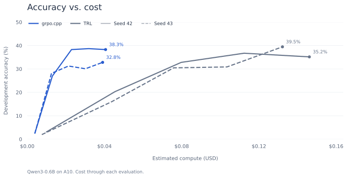
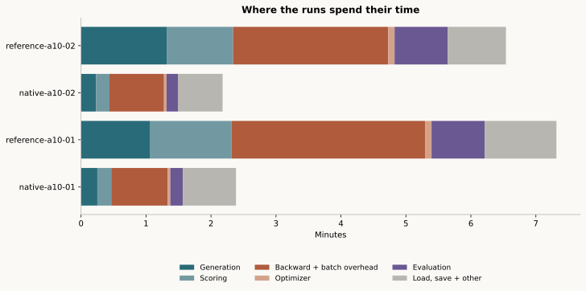
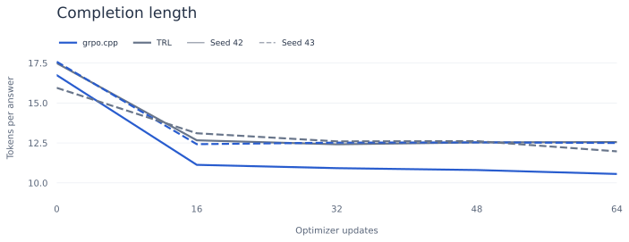
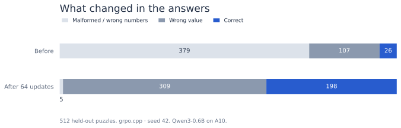
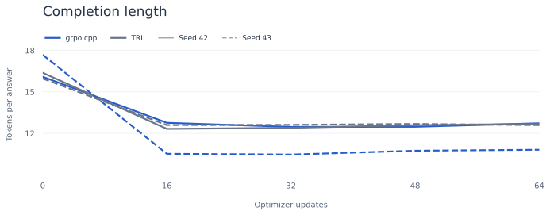
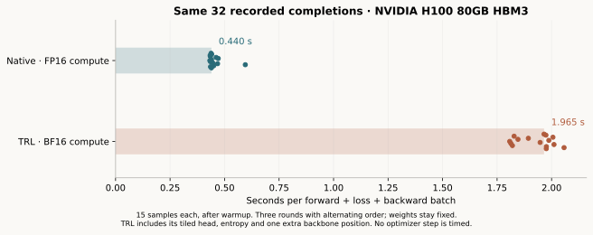
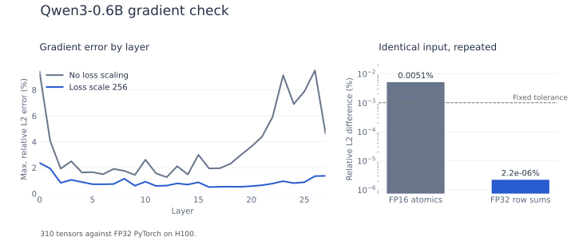

# Countdown

[Browse the recorded answers](https://kartikvashishta.github.io/grpo.cpp/) ·
[Download the checkpoint](https://github.com/KartikVashishta/grpo.cpp/releases/tag/countdown-a10)

Qwen3-0.6B learns to solve three-number Countdown. The training runs below start
from the same model and finish 64 updates. The data splits, verifier and sampling
settings are fixed; prompt order matches within each seed.
Costs below are rate-based estimates for complete training functions, including
saves and reload checks. Image builds, pre-entry startup, storage, network and
the separate final-test job are excluded.

```text
Numbers: 3, 7, 8
Target: 45

(8 + 7) * 3
```

Only one expression is accepted. It must use every input exactly once and
reach the target using `+`, `-`, `*`, `/` and parentheses. The verifier uses
exact fractions. Extra prose, decimals, unary signs, extra numbers and code
are rejected. A valid expression at the token cap can earn reward; the report
records whether it ended with EOS separately. There is no formatting reward.

## 24 GB A10

| Seed | Native development answers | TRL development answers | Native time / cost | TRL time / cost |
| --- | ---: | ---: | ---: | ---: |
| 42 | 7/256 → 98/256 | 8/256 → 90/256 | 143 s / $0.053 | 439 s / $0.161 |
| 43 | 6/256 → 84/256 | 5/256 → 101/256 | 131 s / $0.048 | 392 s / $0.144 |

Both native runs cost about five cents. Native generated 23,537 and 26,094
training tokens; TRL generated 26,501 and 27,195. Shorter answers account for
some of the total-work difference. The fixed-token comparison below uses H100.



<details>
<summary>Timing and completion length</summary>





</details>

Final testing uses 512 separate puzzles, one sampled answer each. Every model
is the last checkpoint at update 64, with no test-driven selection or tuning.

| Seed | Native final test, before → after | TRL final test, before → after |
| --- | ---: | ---: |
| 42 | 26/512 → 198/512 | 14/512 → 183/512 |
| 43 | 14/512 → 179/512 | 19/512 → 199/512 |

Native was faster in both seeds, but the scores went either way. Two seeds
are too few to claim equal learning quality. Native sampled device usage was
about 10.27 GiB; TRL's peak reserved memory was 11.99 GiB. These are different
memory measures, though both trainers fit the 24 GB card.
Modal supplied an A10G for TRL seed 42 and A10s for the other runs.



Most of the early failures are malformed expressions or wrong input numbers.
After training, almost all answers follow those rules, but many still miss
the target. The viewer includes improvements, regressions and remaining failures.

<details>
<summary>H100 comparison</summary>

| Run | Development answers, before → after | Training tokens | Function time | Estimated compute |
| --- | ---: | ---: | ---: | ---: |
| Native, seed 42 | 15/256 → 87/256 | 26,305 | 77 seconds | $0.09 |
| TRL, seed 42 | 10/256 → 107/256 | 26,709 | 398 seconds | $0.46 |
| Native, seed 43 | 10/256 → 113/256 | 22,992 | 89 seconds | $0.10 |
| TRL, seed 43 | 9/256 → 98/256 | 26,318 | 242 seconds | $0.28 |

Native was faster in both runs. Sampled device usage reached 10.60 GiB;
TRL reserved at most 12.83 GiB. Native and TRL use different sampling RNGs
and compute precision.




The H100 final test uses the same 512 puzzles and sampling settings.

| Run | Final-test answers, before → after | Gains | Regressions |
| --- | ---: | ---: | ---: |
| Native, seed 42 | 25/512 → 174/512 | 163 | 14 |
| TRL, seed 42 | 20/512 → 214/512 | 205 | 11 |
| Native, seed 43 | 12/512 → 196/512 | 187 | 3 |
| TRL, seed 43 | 15/512 → 202/512 | 195 | 8 |

TRL scored higher in both seeds. Gains and regressions count puzzles whose
sampled answer changed from wrong to right or right to wrong.

For a fixed-work check, both implementations replay the same 32 completions,
including their original token IDs, masks and centered rewards. Weights stay
fixed. Across three alternating rounds and 15 timed batches each, median
forward/loss/backward time is 0.440 seconds native and 1.965 seconds TRL.
Generation, clipping and optimizer steps are outside this measurement.



TRL keeps its tiled head, entropy and clipping metrics. It computes one extra
backbone position per row; native includes host copies and stage synchronization.
Native uses FP16 compute, TRL BF16 autocast with FP32 parameters. The 4.92%
gradient-norm difference checks scaling only. The full gradient comparison is
below.

</details>

## Run it

Install [Git](https://git-scm.com/downloads) and [uv](https://docs.astral.sh/uv/getting-started/installation/),
and create a [Modal account](https://modal.com/). CUDA and the GPU dependencies
are installed remotely; you do not need a local GPU.

```bash
git clone https://github.com/KartikVashishta/grpo.cpp.git
cd grpo.cpp
uv venv --python 3.11
source .venv/bin/activate
uv pip install modal==1.6.2 pyarrow==24.0.0
modal setup
python3 -m unittest discover -s tests -p 'test_countdown.py' -v
python experiments/countdown/prepare.py
modal run experiments/countdown/native_run.py --build-only
modal run experiments/countdown/native_run.py --mode train --gpu A10 --run-id native-01
```

The runner creates `grpo-countdown` in your active Modal environment. Each run
needs a new ID. This uses the seed-42 prompt order from the bundled results;
there is no prerequisite TRL run. Add
`--reference-run reference-a10-02` for seed 43, or supply a fresh reference run
saved locally and in the Modal volume. To run that reference yourself:

```bash
modal run experiments/countdown/modal_run.py --run-id calibration-01 --gpu A10
modal run experiments/countdown/modal_run.py --run-id reference-01 --mode train --steps 64 --gpu A10
```

Both runners accept L4, A10 and H100, with two CPU cores, 16 GiB RAM and no
retries. The reference defaults to L4; native defaults to H100.

| GPU | Training stop check | Hard timeout | Compute at the timeout |
| --- | ---: | ---: | ---: |
| L4 | 50 min | 60 min | $1.02 |
| A10 | 50 min | 60 min | $1.32 |
| H100 | 15 min | 20 min | $1.39 |

These are per-job estimates at the recorded rates, with the exclusions above.
The scripts do not enforce an account-wide spending limit.

The model and recipe are in `config.json`, split hashes in
`data_manifest.json`, and Python 3.11 dependencies in `requirements.lock`. The
source has 490,364 rows and 200,402 distinct three-number puzzles. We hash
each sorted input multiset plus target, sort those hashes using a fixed seed,
then take 128 calibration, 256 development, 512 final-test and 8,192 training
puzzles. Source row order and permutations cannot cross splits. Training does
not read final-test puzzle contents.

Calibration started at 0/1,024 correct answers. Adding two format examples
gave 36/1,024 and 29 groups with mixed rewards. Both attempts are saved; the
examples are absent from all four data splits.

The runner uses full-support sampling at temperature 1, eight completions per
prompt and a 64-token cap. Each optimizer update sees four prompts, with two
completions per training microbatch. Rewards are centered within each group,
without standard-deviation scaling. Sequence-mean GRPO, one policy pass and
zero KL are used throughout.

The reference uses FP32 parameters and AdamW state, BF16 autocast, gradient
checkpointing and TRL 1.16's tiled output head. Generation uses Transformers
(`use_vllm=False`). Native uses FP16 matrix weights and gradients, FP32 norms,
and FP32 master weights and Adam state.

The C++ process owns generation, gradients and Adam. Python supplies tokenized
puzzles and rewards through `native.py`; `native_train.py` uses the same exact
verifier as the pilot.

To change the task, start with `messages()` and `verify()` in `task.py`.
The model process accepts token IDs for generation and one reward per response
for the update. Prompt construction and reward calculation need no CUDA changes.

## Read the result

Small measurement files return to `runs/countdown/<run-id>/`. Model checkpoints
stay under the same ID in the `grpo-countdown` Modal volume. Training saves
HF model checkpoints every 16 updates. A reload check compares sampled token
IDs on 32 development prompts. Checkpoints contain model weights and tokenizer
files; training restarts with fresh optimizer state.

- `metadata.json`: recipe, source hashes, dependency versions and data identity.
- `answers.jsonl`: every calibration/development answer and exact verdict.
- `evaluations.jsonl`: held-out pass@1, lengths, cap counts and memory.
- `rollouts.jsonl` and `training.jsonl`: sampled training answers and trainer logs.
- `summary.json`: completion status and synchronized stage timings.
- `container.json`: function runtime and rate-based compute estimate.

Timings use synchronized wall-clock intervals for generation, reward, scoring,
loss, optimizer and evaluation. The remainder of each training step includes
backward and batch preparation. Total time also includes loading, saving,
reload checks and writing results. Costs use elapsed time and public rates.

Generate the plots and a standalone answer viewer from saved measurements:

```bash
uv run --with matplotlib==3.10.8 python experiments/countdown/report.py \
  runs/countdown/native-01 runs/countdown/reference-01 \
  --output runs/countdown/report
```

You can pass just the calibration directory before a training run exists.
The report saves SVG and PNG figures beside `report.html`. Each line shows
one seed's sampled development pass@1. Timing, completion length and measurement
notes are under “Training details” in the report. With `--test`, the page opens
on paired final-test answers. Intermediate development answers keep their update slider.

The measurements and raw answers are in `results.tar.gz`.
To redraw these figures without a GPU:

```bash
mkdir -p runs/countdown
tar -xzf experiments/countdown/results.tar.gz -C runs/countdown
uv run --with matplotlib==3.10.8 python experiments/countdown/report.py \
  runs/countdown/native-a10-01 runs/countdown/reference-a10-01 \
  runs/countdown/native-a10-02 runs/countdown/reference-a10-02 \
  --test runs/countdown/test-a10-01 --output runs/countdown/report-a10
uv run --with matplotlib==3.10.8 python experiments/countdown/report.py \
  runs/countdown/reference-h100-01 runs/countdown/native-h100-01 \
  runs/countdown/reference-h100-02 runs/countdown/native-h100-02 \
  --benchmark runs/countdown/fixed-work-h100-02 --test runs/countdown/test-h100-01 \
  --output runs/countdown/report
```

To repeat fixed-work timing or evaluate new 64-update checkpoints:

```bash
modal run experiments/countdown/native_run.py --mode benchmark --run-id fixed-work-01
modal run experiments/countdown/native_run.py --mode test \
  --gpu A10 --test-runs native-01,reference-01 --run-id test-01
```

The final-test command checks the run metadata, split hash and final weight
files, then saves every answer. It never selects an earlier checkpoint.
Pass `--test runs/countdown/test-01` to the report to browse those answers.

Native saves at updates 16, 32, 48 and the end; TRL also writes a periodic
checkpoint at 64 before its final save. Total times include that work.

## Try the published checkpoint

The [release](https://github.com/KartikVashishta/grpo.cpp/releases/tag/countdown-a10)
contains `native-a10-01` after 64 updates, its license and SHA-256 checksums.
The download is about 1.92 GB and needs about 2.4 GB after extraction.
No Modal account is needed.

```bash
mkdir -p runs/countdown/native-a10-01
curl -fL -o runs/countdown/native-a10-01/checkpoint.tar.gz \
  https://github.com/KartikVashishta/grpo.cpp/releases/download/countdown-a10/countdown-native-a10-01.tar.gz
tar -xzf runs/countdown/native-a10-01/checkpoint.tar.gz -C runs/countdown/native-a10-01
uv run --python 3.11 --with torch==2.14.1 --with transformers==5.21.0 \
  python experiments/countdown/sample.py runs/countdown/native-a10-01/final \
  --numbers 26 79 99 --target 46
```

The sampler uses CUDA, Apple Silicon or CPU, whichever is available. It applies
the training prompt and prints the verifier's verdict. New samples may differ
from the recorded demo. See the [checkpoint notes](checkpoint.md) for model identity.

To download a checkpoint from a run in your own Modal workspace:

```bash
mkdir -p runs/countdown/native-01
modal volume get grpo-countdown native-01/final runs/countdown/native-01
```

<details>
<summary>Model checks</summary>

[`RL.cu` at `77ecd83`](https://github.com/KJLdefeated/RL.cu/tree/77ecd8385d9836bc8377e042f4e2b7dd0b6df9c6)
provides the MIT-licensed model and kernels. CMake fetches that revision; a
patch checks weight shapes, dtypes and file bounds, handles FP32 weights,
and sums repeated-token embedding gradients in FP32. The upstream trainer is unused.

```bash
modal run experiments/countdown/native_run.py --run-id native-parity-01
```

This compares two padded Countdown sequences with PyTorch on an H100: selected
log probabilities, every parameter gradient, loss scaling, microbatch
accumulation, changed padding and FP32 weight loading. It includes EOS and
crosses attention and vocabulary-head chunk boundaries. CUDA memcheck runs on
the scaled case. Fixed tolerances live in `parity.py`; a failed comparison
exits nonzero after saving results. The embedding reduction scans matching
rows in order. This keeps short microbatches reproducible without a full FP32
vocabulary-gradient buffer.

`native-parity-02` passes the native checks on the fixed two-sequence fixture. Its
relative gradient error against FP32 PyTorch is 0.56% with scaling and 1.55%
without. The first run failed the repeat check; summing repeated embedding
rows in FP32 brought the difference below the original tolerance. Both runs
are in `results.tar.gz`.



After extracting the bundle, redraw this figure with:

```bash
uv run --with matplotlib==3.10.8 python experiments/countdown/plot_parity.py \
  runs/countdown/native-parity-01 runs/countdown/native-parity-02 \
  --output runs/countdown/report/gradients
```

The optimizer/checkpoint check is a separate run:

```bash
modal run experiments/countdown/native_run.py --mode update --run-id native-update-01
```

This compares clipped Adam updates with PyTorch using identical gradients,
then checks a native roundtrip and a Transformers reload. `native-update-01`
passed three updates over all 310 parameter tensors. The largest absolute
weight difference was 1.2e-7; both reloads preserved all saved weights.

The generation check exercises the KV cache, EOS, full-prefix scoring, one
controlled-reward update, checkpoint reload and memcheck:

```bash
modal run experiments/countdown/native_run.py --mode generation --run-id native-generation-check
```

`native-generation-04` passed. Selected-token log probabilities differ from
FP32 PyTorch by at most 0.0082. Greedy output can differ across batch sizes at
FP16 ties; the check verifies the selected token is an actual maximum, with
unchanged probability tolerances. It also catches a sampler bug where a uniform
rounded to 1 and produced infinite noise. Earlier failed runs are retained.
The same generation, update, reload and memcheck checks also passed on L4 and
A10. Full learning runs here use A10 and H100.

</details>

Sources: [Qwen checkpoint](https://huggingface.co/Qwen/Qwen3-0.6B/tree/c1899de289a04d12100db370d81485cdf75e47ca),
[Countdown data](https://huggingface.co/datasets/Jiayi-Pan/Countdown-Tasks-3to4/tree/408f70d177020686d34a56bba5952feb45aaaee4),
[TRL 1.16 source](https://github.com/huggingface/trl/tree/1b5c75ed94b7387f42532adb090c935166d4878d),
[Modal rates](https://modal.com/pricing). Rates checked 28 October 2026.
The dataset card does not state a license. `prepare.py` downloads the source
dataset; the results archive keeps the puzzles and answers from these runs.
